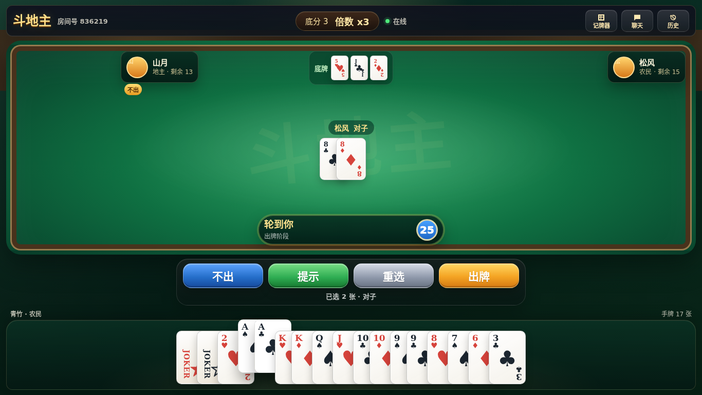

<div align="center">
    

# 🎮 斗地主

**一个真正公平的斗地主游戏 - 无控牌、无算法操控、纯粹的运气与技巧**

基于 Go 语言实现的斗地主游戏，支持联网对战、断线重连、智能机器人等功能。

单实例服务支持 Redis 权威快照与重启续局。部署条件、故障策略和备份恢复步骤见[重启恢复说明](docs/restart-recovery.md)。

[](https://hub.docker.com/r/palemoky/fight-the-landlord)
[](https://github.com/palemoky/fight-the-landlord/actions/workflows/test.yml)
[](https://github.com/palemoky/fight-the-landlord/actions/workflows/release.yml)
[](https://www.gnu.org/licenses/gpl-3.0)

</div>

## 项目初衷

在某些知名斗地主游戏中，新手或回归玩家刚开始会获得好牌，匹配豆子少的对手，营造"连胜"的错觉。但随着游戏时间增长，牌质量明显下降，且频繁匹配高段位玩家，导致快速输光豆子。这种算法操控严重破坏了游戏的公平性和纯粹性，在本项目中：

- **真随机发牌**：每局洗牌完全随机，无任何控牌算法
- **公平匹配**：不考虑胜率、段位、游戏时长，纯随机或房间匹配
- **开源透明**：所有代码公开，欢迎审计和贡献
- **无内购无广告**：纯粹的游戏体验，技巧决定胜负

> **核心理念**：斗地主应该是运气与技巧的博弈，而不是算法与钱包的较量。

## 游戏截图



## 快速开始

### 网页游玩与真人数据采集

项目仅支持浏览器游玩，支持房间联机、人机练习、移动端和刷新重连。
将 `landlord.pt`、`farmers.pt` 放入 `douzero/models/`，运行：

```bash
docker compose up -d --build
```

浏览器打开 `http://localhost:1780`。此部署启用匿名牌局采集，并分别加载地主和农民 MARVEL v1.3
权重。部署配置、本地开发、数据格式与训练样本导出见 [网页部署指南](docs/web-play.md)。

### 部署与本地开发

默认镜像包含网页和 Go 服务。MARVEL 推理镜像需要只读挂载上述两份权重。
已发布版本可执行 `docker compose pull && docker compose up -d`；本地开发使用
`npm run dev` 和 Go 服务，步骤见[网页部署指南](docs/web-play.md)。

CLI 已退役，旧客户端停止连接，历史源码保留在 Git 标签中。网页首次使用创建游客身份。
现有部署升级前请阅读[Web-Only 迁移说明](docs/web-only-migration.md)，沿用原项目名和数据卷。

## 游戏规则

与常见的斗地主相同，开局叫地主后，两位农民需配合击败地主，地主则需要阻击两个农民，率先出完手牌的一方获胜。

叫抢资格、流局和特殊牌型边界见 [经典三人规则基准](docs/classic-rules.md)（含腾讯公开规则来源及未明确的细节）。

### 牌型示例

```
单张: 3, K, 2
对子: 33, KK
三张: 333
三带一: 3334
三带二: 33344
顺子: 34567 (5张+)
连对: 334455 (3对+)
飞机: 333444 (两个连三+)
飞机带单: 33344456
飞机带对: 3334445566
四带二: 333345
四带两对: 33334455
炸弹: 3333
王炸: 小王大王
```

---

<div align="center">

**让斗地主回归纯粹 - 无控牌，真公平**

Made with ❤️ by [palemoky](https://github.com/palemoky)

</div>
