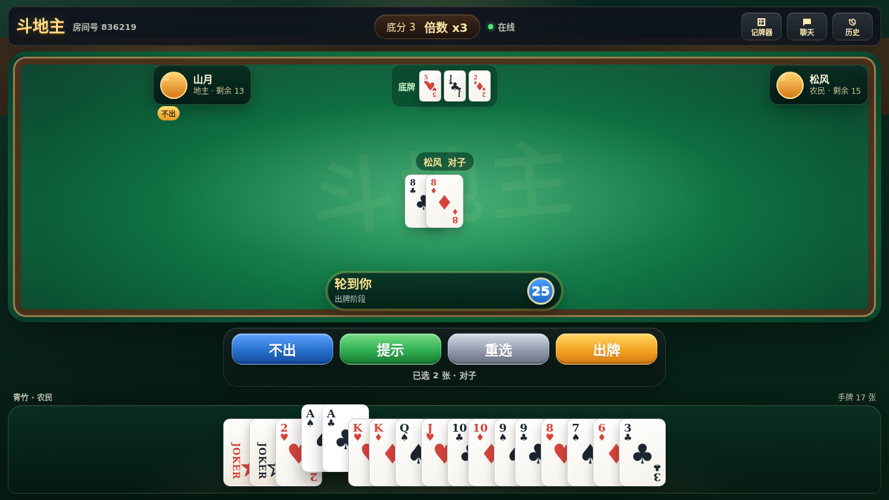

# 网页部署、真人数据采集与双权重推理

网页客户端基于 [PR #65](https://github.com/palemoky/fight-the-landlord/pull/65)
的 `ff667761eda2a0875024b5e3f8a950ebdda08e0a`（作者 anby-jp），沿用项目 GPL-3.0
许可。在此基础上使用服务端同一份 protobuf 定义，并补齐静态托管、重连和结算后再开局。

同一身份同时打开多个页面时，最后一次重连的页面接管牌局；旧页面收到 WebSocket
关闭码 `4001` 后停止自动重连并显示提示。普通网络断线仍自动重连。
人机/真人模式保存在当前标签页的 `sessionStorage`，刷新恢复后“再来一局”沿用该模式。
服务端在准备完成后锁定三个座位，牌局中拒绝退出、切换房间和重复匹配；断线仍可重连。
结算快照保留 2 分钟，随后由每分钟清理任务回收房间、会话及计时器（最迟约 3 分钟）。
清理旧牌局不会影响已经加入的新房间，也不会删除训练记录。没有机器人且全员断线的房间立即
终止并记录 `aborted`；人机房间中的机器人仍在线时，按原有离线托管规则继续。
网页允许手动提交所选牌，由服务端判定合法性；“提示”目前仅生成基础牌型，缺少提示时仍可手动选牌。

## Docker 一键部署

需要 Docker Compose v2。首次构建需要访问 npm、Go、PyTorch 和 GitHub。

1. 克隆本仓库并进入根目录。
2. 将两个权重放到以下位置（本次工作区已放好，Git 不追踪权重）：

   ```text
   douzero/models/landlord.pt
   douzero/models/farmers.pt
   ```

3. 确保容器内用户能够只读访问模型，再启动：

   ```bash
   chmod 755 douzero/models
   chmod 644 douzero/models/landlord.pt douzero/models/farmers.pt
   docker compose -f compose.web.yml up -d --build
   ```

4. 浏览器打开 `http://localhost:1780`，或 `http://服务器IP:1780`。
   可以创建房间邀请好友、快速匹配，或立即开始人机练习。

此 Compose **从当前源码构建**，不使用尚未包含网页功能的旧版公开镜像。
网页和 `/ws` 共用 Go 服务的端口。AI、Redis 不向宿主机暴露端口。
模型目录以只读方式挂载；训练记录和 Redis 使用独立持久卷。
普通 `docker compose down` 保留数据，`down -v` 会删除持久卷。

自定义端口、来源和采集开关示例：

```bash
SERVER_PORT=8080 SECURITY_ALLOWED_ORIGINS=https://ddz.example.com \
COLLECT_TRAINING_DATA=true docker compose -f compose.web.yml up -d
```

域名部署时，将 HTTPS 反向代理指向容器的 1780 端口，并支持 `/ws` 的 WebSocket Upgrade。
网页自动选择 `ws://` 或 `wss://`。`SECURITY_ALLOWED_ORIGINS` 支持逗号分隔的完整 Origin。

## 本地运行

Go 版本见 `go.mod`；Node 22+；MARVEL 推理建议使用 Python 3.12。

```bash
# 网页构建
cd web
npm ci
npm run build
cd ..

# Python 环境和 CPU 推理依赖
python3.12 -m venv douzero/.venv
douzero/.venv/bin/python -m pip install 'torch>=2.6,<3' --index-url https://download.pytorch.org/whl/cpu
PYTHON="$PWD/douzero/.venv/bin/python" bash scripts/setup-marvel.sh

# 单独终端启动 AI，两个 .pt 文件须已放在 douzero/models
AI_BACKEND=marvel douzero/.venv/bin/python douzero/server.py

# 单独终端启动 Redis
redis-server

# 单独终端启动游戏与网页
WEB_DIR=web/dist COLLECT_TRAINING_DATA=true go run ./cmd/server
```

开发网页可在 `web/` 下执行 `npm run dev`，打开 `http://localhost:5174`。
`web/.env.example` 中的 `VITE_WS_TARGET` 同时控制 `/ws` 和 `/api` 的开发代理。
仅运行终端客户端时，可以不设置 `WEB_DIR`。

网页大厅、牌桌和结算按当前可视窗口分配高度；手机竖屏使用两行手牌，横屏使用全宽手牌。
中央显示当前需要跟的牌，左右保留玩家身份、余牌和叫抢／不出标记；完整动作可从“历史”查看。
聊天、记牌器和历史按需展开，长列表与结算的“剩余手牌”在面板内滚动，主要操作保持可见。
仅预览界面时，可在开发地址后加 `?demo=lobby`、`?demo=bidding`、`?demo=table` 或 `?demo=result`；
演示状态不连接游戏服务，不能用来验证真实对局。`?demo=practice` 可预览人机头像。

人机练习使用六款统一风格头像，每桌两个机器人由随机 ID 稳定分配不同头像。
刷新、重连、叫抢身份变化和流局重发不换头像；新练习桌重新分配。桌面和手机横竖屏
均显示头像，加载失败回退昵称首字，真人对手保留首字头像。头像共约 59 KB，每桌只加载
所选的两张。服务端和网页需同步更新以传递 `is_bot` 字段；旧服务端仍显示首字。



### 对局音效

桌面和手机牌桌工具栏提供音效开关，首次访问默认开启，偏好保存到 `localStorage`。
关闭后刷新页面或重新打开同一网站仍保持关闭，再次开启则保存为开启；
清除网站数据后恢复默认开启。浏览器禁用存储时，选择仅在当前页面生效。
开启后播报自己和对手经服务器确认的出牌；单张（含大小王）、对子和三张报点数，
组合牌报牌型，顺子、飞机、炸弹和王炸追加特效，未知牌型使用普通出牌声。
叫地主／不叫／抢地主／不抢和过牌也只在服务器确认后播报。出牌后剩一张／两张时，
按服务端余牌数接在本次报牌及特效后播报，避免人声重叠。
自己的叫／抢／反抢及出牌回合开始时均不播放提示音（不调用 `turn.mp3`，保留音频资源）；
两种回合都在剩 5 秒时提醒一次（`warning.mp3`），报牌和服务器确认后的叫抢语音照常播放。
回合结束或超时立即取消待播及正在播放的回合提示，视觉倒计时不受静音影响。
回合提示使用 30% 增益，发牌 45%，结算 60%。
每局初始 17 张手牌发牌时播放一次，地主补到 20 张不重复播放；胜负按服务端阵营判断，
农民队友出完牌也播放胜利音效。结算前保留最后一手报牌及特效，丢弃更早的待播动作。
本批未加入背景音乐、人物切换、特色压制语音或选牌提示。

音频直接复用 `internal/sound/gaming` 的 66 个 CLI MP3（约 419 KiB），通过 Vite
导入并输出到 `dist/assets/*.mp3`。开发服务器允许访问该资源目录，`Dockerfile.web`
也将其复制进构建阶段；不要改成 `public/audio`，Go 静态服务仅放行 `/assets` 下的文件。
音频开启后按需加载并缓存，加载或播放失败不会阻塞对局。

仅实时服务器事件触发音效，刷新、重连快照和组件重挂载不会补播历史。
重连后补发的当前回合通知（含倒计时）和已结束牌局的结算也不补播。
事件串行播放，最多保留 3 组待播，超过 3 秒尚未开始的普通事件丢弃；已开始的报牌、
特效和余牌语音按顺序完成。回合提示以服务器回合截止时间为限，不会因等待发牌音而
在 3 秒后提前过期；回合提前结束仍立即取消。结算最多等待 10 秒，以便最后一手牌在进入结算页后播完。
加载超时与播放时长分别限制，正常的发牌／胜负长音效不会被 3 秒队列时限截断。
静音、离桌、断线、切后台会停止当前音效、清空队列并取消回合提醒；恢复后不补播。
刷新后已开启的偏好需要再次点击或按键才能解锁声音；iOS Safari 切后台或锁屏后，
若浏览器挂起音频，需要回到页面再交互一次。解锁期间收到的旧出牌不会补播。

验收时除自动测试外，需在 iOS Safari、Android 和桌面浏览器实际听测：各点数与牌型、
自己和对手出牌、非法出牌被拒绝、快速连续出牌、开关与偏好恢复、刷新和重连不补播，
以及锁屏／切后台后停止与恢复。新增事件还应听测四种叫抢、过牌、余牌串接、
叫／抢／反抢及出牌回合开始时无提示音、
5 秒单次提醒、回合结束停止、初始发牌与补底牌、农民队友获胜和最后一手后的结算。
尤其需要根据真机音量和听感复核提示音的增益与频率。开发环境和生产 Go 服务均应确认 MP3 返回 200。
浏览器模拟和自动测试不能替代手机真机听测。

## 两个 .pt 模型的真实适配

上传文件不是 DouZero LSTM 权重，而是
[GentleKingson/doudizhu](https://github.com/GentleKingson/doudizhu)
的 MARVEL / VRPO `v1.3` checkpoint：history_dim=128、feature_dim=256、4 层 decoder。
适配器固定使用训练仓库版本 `acdcf199cf422e2b683cb22142b8e7cb33b14460`，
调用原始 `Agent`、nanopokerlib 观测编码和 Kagami direct-policy 解码。
没有将两个文件伪装为三个 ONNX 模型，也不需要转换权重。

- 地主加载 `landlord.pt`（iteration 26411）。
- 下家农民与上家农民共用 `farmers.pt`（iteration 25011）。
- 使用 `torch.load(weights_only=True, map_location="cpu")`，严格校验全部参数。
- 构造输入时只使用自己的手牌、公开底牌和完整出牌历史，保留 PASS。
- 地主初始私有 17 张牌通过“当前手牌 + 已出牌 − 三张底牌”恢复。
- 直接策略使用 `action_temp=0`；不启用需要额外 belief 权重的搜索模式。
- 启动时缺少权重、架构不符或参数不匹配会明确失败。
- 运行时模型返回值经过合法动作校验；服务异常时 Go 保留原有规则机器人回退并记录日志。

`GET /health` 返回 backend、三个座位、两个模型的 SHA-256 与训练迭代。
Compose 中可在 AI 容器里读取：

```bash
docker compose -f compose.web.yml exec ai python -c \
  "import urllib.request; print(urllib.request.urlopen('http://localhost:2021/health').read().decode())"
```

本次文件校验值：

```text
landlord.pt  00001ec5070a014011fa462e4263fcacd45498a485b3736de27b11b510290e31
farmers.pt   fa1b43a1a0dc075527aa623f3929eb084796016e19f346e778c5f7362d70a0b7
```

原有 ONNX 服务保持兼容，`AI_BACKEND=onnx`（默认）仍按原方式加载三个 `.onnx` 文件。
`DOUZERO_URL` 是 Go 到 AI 的兼容 HTTP 地址，也可指向 MARVEL 后端。
叫/抢地主仍使用原有规则策略，这两个权重用于出牌决策。

## 真人牌局采集

配置文件默认关闭采集；`compose.web.yml` 默认开启。启用时网页顶部显示采集说明。
同一个服务端上的网页和终端对局都会记录；使用终端客户端的参与者也应知晓此服务启用了采集。

| 配置 | 用途 |
| --- | --- |
| `COLLECT_TRAINING_DATA` | `true` 开启，`false` 关闭 |
| `TRAINING_DATA_DIR` | 本地默认 `data/games`，容器为 `/app/data/games` |
| `WEB_DIR` | 网页构建目录，容器为 `/app/web` |

每次发牌生成独立随机 `game_id` 和文件：`日期/game_id.jsonl`。
写入期间后缀为 `.jsonl.partial`；结束记录成功写入、同步后才重命名。
异常退出或磁盘写入失败留下 partial，不进入正常导出。
写入失败有服务端日志，不中断玩家对局；目录不可写则在服务器启动时明确报错。

记录结构（`schema_version=1`）：

- `deal`：三个座位的初始手牌、机器人标记、底牌、流局次数。
- `bid`：动作前手牌、是否叫/抢、决策来源、用时。
- `landlord`：最终地主座位与叫抢倍数。
- `play` / `pass`：动作前手牌、上手牌、剩余数量、地主座位、必须出牌标记、倍数、动作与用时。
- `end`：`completed`、`redeal` 或 `aborted`；正常结束附获胜座位、三个座位的团队胜负标签（±1）、得分、最终倍数。

所有事件均包含时间、game_id、连续递增 seq。`source` 分为 `human`、`bot`、`timeout`、`offline`。
仅在服务端校验通过后记录动作。纯机器人对局不采集。
牌采用 DouZero 点数：3–14 表示 3–A，17 表示 2，20/30 为小王/大王，空数组为 PASS。

记录没有玩家 ID、昵称、IP、聊天或重连令牌，座位号只在本局有意义。
完整初始发牌属于训练用私有信息，只保存在服务端目录；网页没有数据下载接口。
文件权限为 0600，目录 0700。管理员负责备份、保留期限和清理。

## 导出可用于训练的真人动作样本

从 Compose 取出数据（容器需要运行）：

```bash
mkdir -p data
docker compose -f compose.web.yml cp server:/app/data/games ./data/games
python3 scripts/export-training.py data/games --output data/human-decisions.jsonl
```

导出器只接受带正常结束记录的完整牌局，验证初始 54 张牌、事件顺序、回合、手牌变化及终局，
只输出 `source=human` 的出牌/过牌。流局、中断、partial、机器人、超时及离线代打不作为真人标签。
历史中仍保留所有人的合法动作，确保上下文可重建。叫地主决策保留在原始日志，当前导出专用于出牌训练。

每行包含 `game_id`、`seq`、`observation`、`action`、`reward`、`score`、`elapsed_ms`。
`observation` 与 AI `/decide_play` 请求格式一致，包含自己的牌和公开信息，不含对手私有手牌。
可以用 `douzero/src/marvel_backend.py` 的 `build_infoset_string` 转为训练仓库的语义 infoset。
训练/验证集应按 `game_id` 分组切分，防止同一局的相邻决策进入不同集合。
这是一套采集与导出流程，不会自动修改或重新训练上传权重。

## 检查

```bash
go test -race -tags ci ./...
cd web && npm test && npm run build
npx playwright install chromium
npm run test:e2e
# 可选：已运行真实后端时，验证人机整局与刷新恢复
DDZ_LIVE_URL=http://localhost:1780 npx playwright test live.spec.ts --project=desktop
cd ../douzero
.venv/bin/python -m unittest discover -s tests -v
MARVEL_INTEGRATION=1 .venv/bin/python -m unittest discover -s tests -v
```

MARVEL 训练仓库使用 MIT 许可；镜像保留其源码及 LICENSE，安装脚本固定版本。

### 发牌与叫地主时序

首次开局和每次无人叫地主重发，均先进入服务端 `dealing` 阶段，固定等待
`session.DealDuration`（初值 3870 毫秒）后才发送 `bid_turn`，启动完整叫牌倒计时。
不等待客户端回执，掉线、静音、音频加载失败不会暂停这一阶段。调整试听时长时修改该常量；
Web 的动画时长直接取协议字段，无需另改前端常量。

`deal_cards` 与重连 `GameStateDTO` 增加 `deal_id`、`deal_start_at`、`deal_end_at`、
`server_time`（后三者为 Unix 毫秒）。客户端以消息中的服务端时间换算剩余进度；
网络延迟可能使展示略晚，正式 `bid_turn` 到达时立即停止发牌动画和音效。
本地播放结束仍等待正式通知，不能自行开放操作。发牌期间重连不重置服务端时间，底牌保持隐藏。
地主取得底牌时的手牌更新不带发牌时间字段，不重复播放。

`bid_turn` 新增 `bid_token`，Web 和 TUI 必须在 `bid` 请求中原样带回；服务端在会话锁内严格校验，
拒绝缺失或过期令牌。令牌每次叫/抢通知更新，重连补发保留原令牌。
**服务端、Web 与 TUI 应同步升级**：旧客户端不携带令牌，其叫牌请求会被拒绝。
TUI 只显示发牌等待提示，收到正式通知后显示操作和倒计时，不增加牌背动画。

Web 将完整手牌一次存入游戏状态，但画面从 0 张开始：牌背从中央牌堆飞向实际手牌槽位，
每张落地后显示牌面并递增底部数量，最后一张在协议的结束时间落地。布局始终按完整手牌预留，
手机横竖屏切换时重新测量落点；发牌期间不允许选牌。无人叫地主重发从 0 张开始，
发牌中重连按剩余进度恢复，普通重连与地主补牌直接显示完整手牌。正式回合通知提前到达时，
立即显示全部手牌并移除飞牌，不等待本地动画。

Web 在减少动态效果模式下直接显示全部手牌，保留静态牌堆和等待提示；静音、浏览器尚未解锁音频、加载失败时仍正常发牌。
音频加载较慢或发牌中途重连时，跳到剩余片段，不从头重播。
